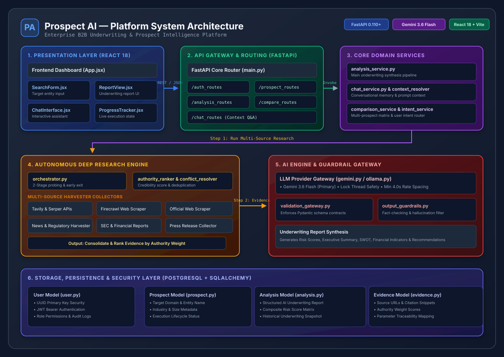
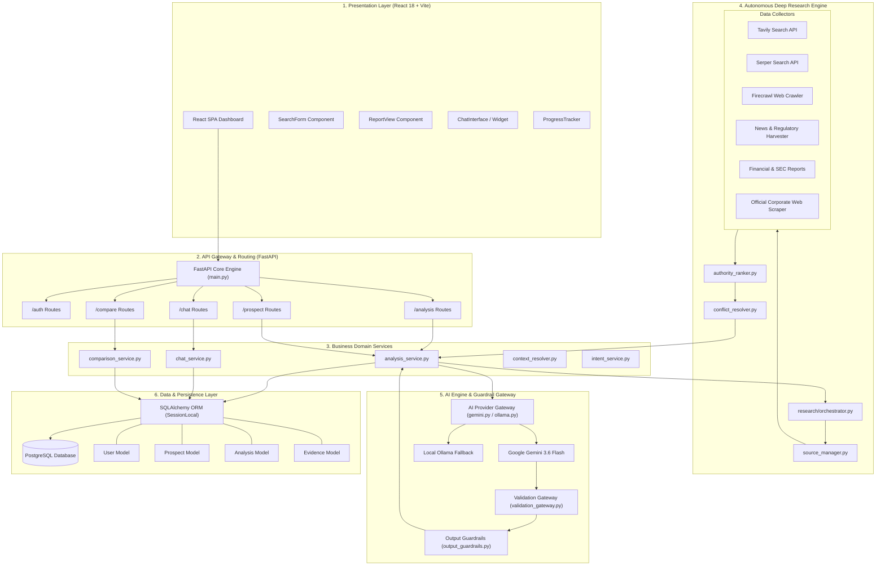

# Prospect AI — System Architecture & Technical Specifications

> **Domain**: Enterprise B2B Underwriting & Prospect Intelligence Platform  
> **Core Stack**: React 18, Vite, FastAPI (Python 3.10+), Gemini 3.6 Flash / Ollama LLMs, PostgreSQL, SQLAlchemy.

---

## 1. Vector Diagram Architecture Preview

---

## 2. High-Level System Topology

Prospect AI is an autonomous B2B underwriting and company intelligence platform. It gathers multi-source web, financial, news, and regulatory evidence about target business prospects, ranks data authority, synthesizes structured underwriting analysis using Google Gemini AI, and presents interactive risk reports to underwriters.

---

## 3. Layer-by-Layer Architectural Breakdown

### 3.1 Presentation Layer (`/frontend`)
- **Technology**: React 18, Vite, Tailwind CSS.
- **Key Modules**:
  - `SearchForm.jsx`: Target entity search & custom parameters.
  - `ReportView.jsx`: Interactive underwriting report layout (SWOT, risk metrics, financial health).
  - `ChatInterface.jsx`: Context-aware conversational assistant.
  - `ProgressTracker.jsx`: Real-time execution pipeline stage tracker.

### 3.2 API Gateway & Routing (`/backend/routes` & `main.py`)
- **Technology**: FastAPI, Pydantic v2, CORS Middleware, HTTP Bearer Security.
- **Key Routers**:
  - `auth_routes.py`: User registration & JWT authentication.
  - `prospect_routes.py`: Prospect entity CRUD.
  - `analysis_routes.py`: Underwriting research pipeline trigger & report retrieval.
  - `compare_routes.py`: Multi-prospect comparison matrix.
  - `chat_routes.py`: Follow-up Q&A API endpoints.

### 3.3 Core Business Services (`/backend/services`)
- `analysis_service.py`: Orchestrates research, AI prompts, and schema extraction.
- `chat_service.py`: Maintains conversation history & evidence context injection.
- `comparison_service.py`: Side-by-side metric comparison across prospects.
- `context_resolver.py` & `intent_service.py`: Classifies user queries to load relevant evidence snippets.

### 3.4 Autonomous Research Engine (`/backend/research`)
- `orchestrator.py`: Implements two-stage probing (probes primary scale parameter first; early exit if no public data exists).
- `authority_ranker.py`: Scores credibility weights across sources.
- `conflict_resolver.py`: Deduplicates and resolves conflicting claims across scraped sources.
- **Harvester Network**: Tavily, Serper, Firecrawl, News, SEC, Financial, Official Web Scrapers.

### 3.5 AI Provider & Guardrail Gateway (`/backend/ai` & `/backend/services`)
- `gemini.py`: Primary client for Google Gemini LLM (`GEMINI_MODEL` configured via environment variable, e.g. `gemini-flash-lite-latest` or `gemini-2.5-flash`). Enforces thread locking and minimum 4.0s call spacing.
- `ollama.py`: Local LLM provider fallback.
- `validation_gateway.py` & `output_guardrails.py`: Validates model outputs against Pydantic schema contracts and suppresses unbacked risk assertions.

### 3.6 Persistence & Security Layer (`/backend/database.py` & `/backend/models`)
- **Database Engine**: PostgreSQL with SQLAlchemy ORM.
- **Connection Strategy**: `pool_pre_ping=True`, pool size 10, max overflow 20.
- **Data Schemas**: `User` (UUID Auth), `Prospect`, `Analysis`, `Evidence`.
