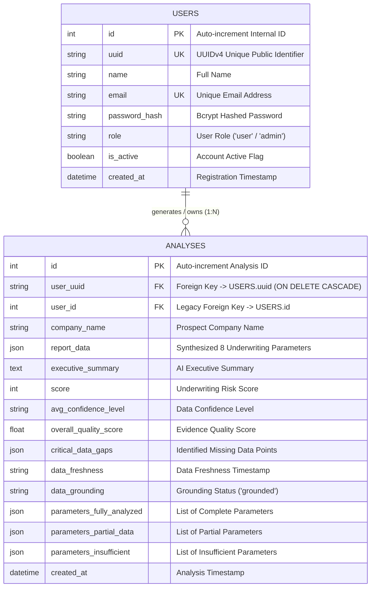

# 📋 Weekly Engineering Work & Implementation Report

**Project:** Insurance Prospect IQ Platform (Prospect AI)  
**Reporting Period:** Weekly Sprint Summary  
**Author / Engineer:** Development Team  

---

## 🎯 Executive Summary

During this sprint, major architectural enhancements, AI integrations, security implementations, and UI/UX modernization were completed. The platform transitioned from a static dashboard paradigm to an **interactive conversational underwriting copilot**, implemented **enterprise-grade JWT authentication** with **UUID-based data isolation**, integrated a **two-tier AI inference engine (Google Gemini + Local Ollama fallback)** coupled with **Tavily AI web search**, and designed an optimized **relational database schema with full Entity-Relationship (ER) modeling**.

---

## 🚀 Key Modules & Features Implemented

```
┌─────────────────────────────────────────────────────────────────────────────┐
│                             SPRINT HIGHLIGHTS                               │
├──────────────────────────────┬──────────────────────────────────────────────┤
│ 1. Conversational Chat UI   │ Interactive Underwriting Copilot & Widget    │
│ 2. JWT Authentication & UUID │ Bcrypt Hashing, Token Guards & Isolation     │
│ 3. Ollama AI + Tavily Search │ Hybrid LLM Architecture + Deep Web Research  │
│ 4. Database & ER Architecture│ PostgreSQL Relational Schema & ER Diagram    │
└──────────────────────────────┴──────────────────────────────────────────────┘
```

---

### 1. 💬 Modernization: Transition to Interactive Chat Interface

#### **Objectives & Implementation:**
* **Chat Interface (`ChatInterface.jsx` & `ChatWidget.jsx`)**:
  * Designed and deployed a dedicated, full-featured underwriting chat copilot and a floating desktop widget.
  * Enables insurance underwriters to ask natural-language questions about analyzed prospect companies (*e.g., "What is their solvency ratio?", "Detail their commercial loss history"*).
* **Smart Parameter Detection & Context Grounding**:
  * Built `detect_parameter_match()` in the backend to automatically map user questions to specific underwriting parameters (*Company Scale, Financial Strength, Technology Activity, etc.*).
  * Automatically injects empirical evidence from the active dossier into the LLM context to eliminate hallucinations.
* **Layout & Navigation Enhancements (`Sidebar.jsx`, `Header.jsx`)**:
  * Added responsive sidebar navigation with instant access to historical search dossiers.
  * Integrated real-time query state indicators and session management.

---

### 2. 🔐 Full-Stack Authentication & Security (Signup, Login & UUID)

#### **Objectives & Implementation:**
* **Cryptographic Security (`backend/auth/security.py`)**:
  * Implemented secure password hashing using **`bcrypt`** with 12 salt rounds before persisting user credentials.
* **JWT Access Token Lifecycle (`backend/auth/jwt.py` & `backend/auth/dependencies.py`)**:
  * Built token issuance and validation using **`HS256`** algorithm with configurable expiration.
  * Created `get_current_user` FastAPI dependency to guard protected endpoints (`/analyze`, `/chat`, `/analyses`, `/auth/me`).
* **Client-Side Auth State & Interceptors (`frontend/src/context/AuthContext.jsx` & `api/client.js`)**:
  * Created centralized React `AuthContext` managing user state, tokens, login, signup, and logout.
  * Configured **Axios Request Interceptor** to automatically inject `Authorization: Bearer <token>` into all outgoing API calls.
  * Configured **Axios Response Interceptor** to detect `401 Unauthorized` responses and trigger clean session invalidation.
* **UUID-Based Multi-Tenant Isolation**:
  * Replaced sequential auto-increment integer IDs with **128-bit UUIDs (`uuid.uuid4()`)** as external foreign keys (`users.uuid` ➔ `analyses.user_uuid`).
  * Enforced strict database-level data isolation preventing ID enumeration (IDOR) attacks and business data leakage.

---

### 3. 🧠 Hybrid AI Synthesis (Ollama Local Fallback + Tavily Search)

#### **Objectives & Implementation:**
* **Tavily AI Web Search Integration (`research/collectors/tavily_search.py`)**:
  * Upgraded the research engine by integrating **Tavily AI Search** alongside Google News RSS, Wikipedia Knowledge Graph, and statutory regulatory registers.
  * Fetches clean, contextual web snippets specifically tuned for financial and corporate intelligence.
* **Local Ollama LLM Fallback (`backend/ai/ollama.py`)**:
  * Built a local LLM integration that communicates with the local Ollama instance (`http://localhost:11434`).
  * Implemented dynamic model detection (`get_active_ollama_model()`) prioritizing lightweight, high-performance models (`qwen2.5:1.5b`, `llama3.2:3b`).
* **Resilient Multi-Tier AI Synthesis Pipeline (`analysis/summarizer.py`)**:
  * **Tier 1 (Primary)**: Google Gemini 3.6 Flash for rapid cloud synthesis.
  * **Tier 2 (Fallback)**: Local Ollama Model when cloud API quotas (HTTP 429) are exhausted.
  * **Tier 3 (Diagnostics)**: Explicit diagnostic reporting identifying root causes if both AI engines fail.
* **Data Sanitization (`clean_fact_text` & `limit_to_sentences`)**:
  * Implemented automated regex filters that strip HTML tags, markdown tables, and navigation noise, generating crisp 3-sentence executive summaries.

---

### 4. 🗄️ Database Architecture & Entity-Relationship (ER) Modeling

The PostgreSQL database architecture consists of two primary relational entities: **`users`** and **`analyses`**, linked through a **1-to-Many Relationship** (`One User -> Many Analyses`) with cascade deletion rules.

#### **Entity-Relationship (ER) Diagram:**



#### **Database Schema Specifications:**

| Table | Column | Type | Constraints / Attributes | Description |
|---|---|---|---|---|
| **`users`** | `id` | `INTEGER` | `PRIMARY KEY`, Indexed | Internal sequential surrogate key |
| | `uuid` | `VARCHAR(36)` | `UNIQUE`, Indexed, `NOT NULL` | Globally unique public identifier (UUIDv4) |
| | `name` | `VARCHAR(255)` | `NOT NULL` | User full display name |
| | `email` | `VARCHAR(255)` | `UNIQUE`, Indexed, `NOT NULL` | Unique user email login credential |
| | `password_hash` | `VARCHAR(255)` | `NOT NULL` | 12-round salted Bcrypt password hash |
| | `role` | `VARCHAR(50)` | `DEFAULT 'user'`, `NOT NULL` | Role-based access control (`admin`/`user`) |
| | `is_active` | `BOOLEAN` | `DEFAULT TRUE`, `NOT NULL` | Account activation state |
| | `created_at` | `TIMESTAMP` | `DEFAULT UTC_NOW`, `NOT NULL` | Account creation timestamp |
| **`analyses`** | `id` | `INTEGER` | `PRIMARY KEY`, Indexed | Unique dossier record identifier |
| | `user_uuid` | `VARCHAR(36)` | `FOREIGN KEY (users.uuid) ON DELETE CASCADE` | Strict ownership link to user UUID |
| | `user_id` | `INTEGER` | `FOREIGN KEY (users.id) ON DELETE CASCADE` | Database integer foreign key reference |
| | `company_name` | `VARCHAR` | Indexed | Name of analyzed prospect enterprise |
| | `report_data` | `JSON` | Structured Object | Complete 8-parameter synthesized dossier |
| | `executive_summary`| `TEXT` | Nullable | C-level concise underwriting overview |
| | `overall_quality_score`| `FLOAT` | `DEFAULT 75.0` | Quality metric for collected research evidence |
| | `created_at` | `TIMESTAMP` | `DEFAULT UTC_NOW` | Creation timestamp of the report |

---

## 📊 Summary of Deliverables & Impact

| Milestone Area | Status | Key Deliverable | Impact |
|---|:---:|---|---|
| **UI Modernization** | ✅ Completed | `ChatInterface.jsx`, `ChatWidget.jsx`, `Sidebar.jsx` | Transformed underwriting experience from static reports to interactive dialog. |
| **Authentication** | ✅ Completed | JWT + Bcrypt + AuthContext + Interceptors | Provided enterprise security, multi-tenancy, and secure session management. |
| **Local LLM Fallback** | ✅ Completed | `ai/ollama.py` + Dynamic Model Detection | Eliminated single point of failure and cloud API quota rate limits. |
| **AI Web Research** | ✅ Completed | `collectors/tavily_search.py` | Significantly enhanced evidence depth and financial accuracy. |
| **Database Architecture**| ✅ Completed | PostgreSQL Schema + UUID Relations + ER Model | Enforced strict data isolation, cascading integrity, and scalable DB design. |

